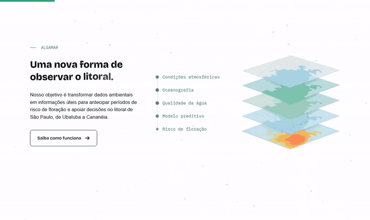
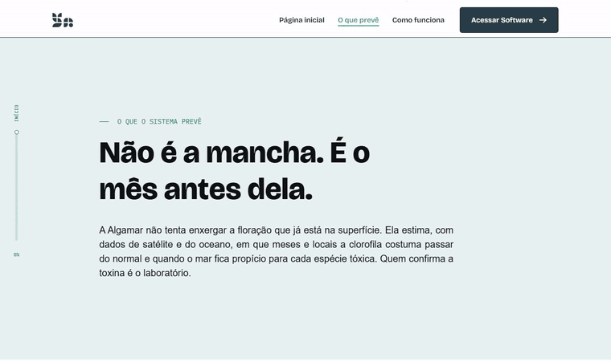
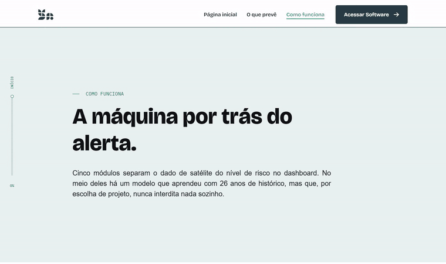
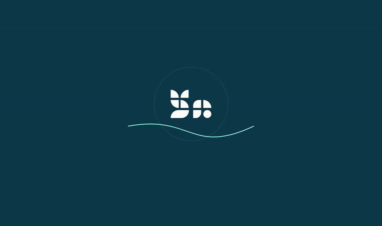
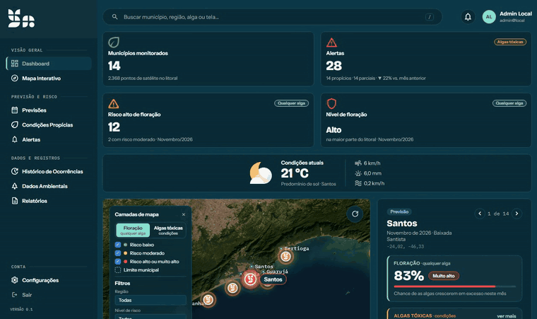
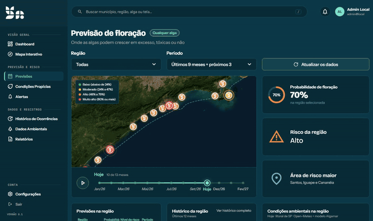
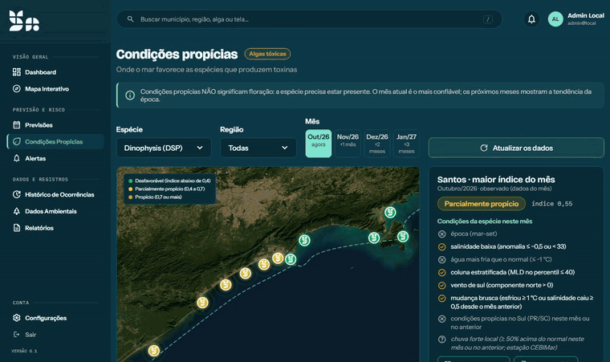

# Algamar — Frontend

Frontend do **Algamar**, sistema que estima o risco de **florações de algas
nocivas (FANs)** no litoral do estado de São Paulo. O projeto é o trabalho de
Análise e Desenvolvimento de Sistemas da **Unifran** (Franca–SP, 2026), com
orientação do Prof. Dr. Renato Gonçalves Rocha.

Este repositório tem a camada que o usuário vê: o site institucional e o
software com login (dashboard, mapa, previsões, alertas, relatórios). Ele é
uma das três partes do sistema. As outras duas estão em
[Visão geral do projeto](#visão-geral-do-projeto).

<p align="center">
  <a href="docs/InicioApresenta%C3%A7%C3%A3o.mp4">
    
  </a>
  <br>
  <sub>Vídeo de apresentação (prévia acelerada)
</p>

> **Como ler os resultados:** o Algamar mostra **risco estimado**, e isso não
> é o mesmo que uma floração confirmada. O alvo do modelo é um indicador de
> biomassa (clorofila-a máxima mensal > 1,5 mg/m³). Ele não identifica a
> espécie, não conta células e não mede toxinas. Os números servem para
> escolher onde e quando observar mais de perto. Eles não substituem análises
> de laboratório nem a vigilância oficial.

---

## Sumário

- [Documentos do projeto](#documentos-do-projeto)
- [Visão geral do projeto](#visão-geral-do-projeto)
- [Minha colaboração no Machine Learning](#minha-colaboração-no-machine-learning)
- [Este repositório (frontend)](#este-repositório-frontend)
- [Demonstração em GIFs](#demonstração-em-gifs)
- [Rodando localmente](#rodando-localmente)
- [Rotas da API usadas](#rotas-da-api-usadas)
- [Dados e limitações](#dados-e-limitações)
- [Equipe](#equipe)

---

## Documentos do projeto

A pasta [`docs/`](docs/) traz os documentos acadêmicos e o vídeo de
apresentação do projeto:

| Arquivo | O que é |
|---|---|
| [`docs/Artigo_Algamar.pdf`](docs/Artigo_Algamar.pdf) | **Artigo** *"Algamar: um sistema preditivo de florações de algas nocivas no litoral do estado de São Paulo"*. Analisa os relatórios emitidos pelo sistema em 29/10/2026 para 14 municípios: distribuição das classes de risco, ranking por município, condições ambientais, índice de condições propícias por espécie e projeção de nov/2026 a jan/2027. Também discute as limitações. |
| [`docs/InicioApresentação.mp4`](docs/InicioApresenta%C3%A7%C3%A3o.mp4) | **Vídeo de apresentação** (43 s, com som). Mostra a pergunta "onde a alga tóxica vai florescer?", o modelo que aprende o mar com dados de satélite e o mapa de risco três meses à frente. |
| [`docs/Documentacao_Tecnica_Algamar.pdf`](docs/Documentacao_Tecnica_Algamar.pdf) | **Documentação técnica** (v1.0, set/2026). Cobre a arquitetura, as fontes de dados (Copernicus Marine e Open-Meteo), os pipelines de ML, a API FastAPI, o backend Node/Express, o banco PostgreSQL, a segurança, a infraestrutura via Tailscale, o versionamento e o frontend (Capítulo 14). Também lista as limitações e as pendências. |

Resultados do artigo, para referência rápida (saídas do sistema, **não**
florações confirmadas):

- **Out/2026:** a probabilidade média foi de cerca de 75%. Sete municípios
  ficaram em risco muito alto, cinco em alto e dois em moderado.
- **Maiores probabilidades estimadas:** Cananéia (92%), Iguape (90%) e Ilha
  Comprida (87%). As menores foram Ubatuba (47%) e Ilhabela (34%).
- **Médias ambientais:** água a 21,0 °C, salinidade de 35,3 PSU e clorofila-a
  de 1,7 µg/L.
- **Índice de condições propícias (0 a 1):** *Pseudo-nitzschia* 0,71 (o
  maior), *Gymnodinium catenatum* 0,67, *Dinophysis* 0,47 e *Alexandrium
  catenella* 0,39.
- **Projeção da média:** 70% em nov/2026, 60% em dez/2026 e 68% em jan/2027.

> A documentação técnica v1.0 descreve o ML **como estava em setembro de
> 2026**: um Random Forest sazonal com 9 atributos e limiar de 0,2. Depois
> disso, o ML foi reescrito no ramo `feat/TulioML` (ver a próxima seção). As
> rotas novas aparecem na Seção 6.3 da documentação, mas sem o contrato
> completo.

---

## Visão geral do projeto

```
Copernicus Marine (CHL, SST, SSS)   Open-Meteo (tempo e mar)
            │                                 │
            ▼                                 │
  Machine Learning (Python)                   │
  pipeline + modelo + API FastAPI :8000       │
            │  /forecast, /coastal-risks,     │
            │  /condicoes-propicias ...       │
            ▼                                 │
  Backend (Node.js/Express + PostgreSQL) :3000│
  JWT, regras de negócio, histórico           │
            │  /api/...                       │
            ▼                                 ▼
  Frontend (este repositório) — site público + software com login
```

| Componente | Tecnologia | Repositório |
|---|---|---|
| Machine Learning e API de inferência | Python, pandas, xarray, XGBoost, FastAPI | [joaopetruz/AlgaMar_MachineLearning](https://github.com/joaopetruz/AlgaMar_MachineLearning) |
| Backend | Node 20, TypeScript, Express 5, PostgreSQL (`pg`), JWT, bcrypt | `algamar_backend` (repositório separado da equipe) |
| Frontend | HTML, CSS e JavaScript puros | este repositório |

O frontend fala **só com o backend**. Quem chama a API de ML é o backend, que
depois autentica, classifica, persiste e devolve tudo em `/api/...`. Para
testar sem o backend, existe o `dashboard_local.py` do repositório de ML (ver
[Rodando localmente](#rodando-localmente)).

---

## Minha colaboração no Machine Learning

Além do frontend, fiz a reformulação do Machine Learning no repositório
[**joaopetruz/AlgaMar_MachineLearning**](https://github.com/joaopetruz/AlgaMar_MachineLearning),
no ramo
[`feat/TulioML`](https://github.com/joaopetruz/AlgaMar_MachineLearning/tree/feat/TulioML).
O Pull Request [#1](https://github.com/joaopetruz/AlgaMar_MachineLearning/pull/1)
leva esse trabalho ao `main`.

**O que mudou em relação ao modelo original da equipe:**

- **Previsão de verdade, 12 meses à frente.** O modelo sazonal antigo
  (`/predict`, `/predictions`) só classificava um mês que já tinha sido
  observado. O novo pipeline estima a probabilidade de floração em cada ponto
  da grade de cerca de 4 km, em cada um dos 12 meses seguintes ao último mês
  observado.
- **Correção de vazamento de dados.** As médias históricas passaram a excluir
  o ano corrente, os hotspots passaram a ser recalculados só com dados até
  2018 e as distâncias passaram a ser medidas em km (haversine). A divisão
  entre treino e teste é temporal.
- **Todo o litoral de SP.** A área antiga deixava de fora Iguape, Ilha
  Comprida e Cananéia. Agora ela vai de lon −48,2 a −44,8 e de lat −25,7 a
  −23,3.
- **Modelo e registro.** É um XGBoost com a climatologia como base, mais um
  ensemble de ordens. Cada modelo fica registrado de forma imutável (SHA-256)
  e tem um cartão com as métricas (PR-AUC, ROC-AUC, Brier, calibração). O
  modelo oficial e as *feature flags* ficam em `config/ml.toml`.
- **Pipeline único** (`algamar.py treinar | previsao | modelos`). Ele baixa os
  dados novos do Copernicus (MY/REP + NRT) e grava as saídas padronizadas em
  `saidas/<run_id>/` e `saidas/ULTIMA.json`, com logs.
- **API nova:** `/forecast`, `/forecast/janela`, `/forecast/mapa`,
  `/forecast/regioes`, `/forecast/meta`, `/coastal-risks`, `/observado`,
  `/condicoes-ambientais`, `/condicoes-propicias` (+ `/historico`),
  `/teste/meses`, `/teste/hindcast` e `/testar`.
- **Índice de condições propícias** para espécies potencialmente tóxicas
  (*Dinophysis*, *Alexandrium catenella*, *Gymnodinium catenatum* e
  *Pseudo-nitzschia*). As regras vêm da literatura (`indice_condicoes.py`,
  `docs/fichas_especies_condicoes.md`). Esse índice é o que alimenta a tela
  **Condições Propícias** deste frontend.
- **Hindcast:** é possível comparar uma previsão emitida no passado com o que
  aconteceu depois (`/teste/hindcast`, página `testar_ml.html`).
- **`dashboard_local.py`**, que sobe uma API no formato do backend na porta
  3000, para rodar o frontend completo sem a máquina do backend.
- **Testes automatizados** com `pytest` (mais de 100), algo que a
  documentação v1.0 apontava como ausente.
- **Experimentos com física oceânica**, usando CROCO (Navier–Stokes) e
  reanálise GLORYS. Eles foram testados e **não melhoraram** a previsão, então
  ficam desligados na configuração oficial e documentados em
  `docs/RELATORIO_FECHAMENTO_RISCO_FLORACAO.md`.

**Status honesto:** o resultado está como *hindcast validado* (PR-AUC de
cerca de 0,78 no teste). Na prática, o produto é um **risco climatológico
ajustado pelo satélite**: ele acerta onde e em que mês costuma florescer, mas
não supera a climatologia em anomalias. Para prever alga **tóxica** de fato,
faltam as séries oficiais de contagem de células e ficotoxinas (CDA/PEMMOBI e
CETESB), que não são públicas.

---

## Este repositório (frontend)

HTML, CSS e JavaScript puros: não há framework, etapa de build nem
dependências npm. O que vem de fora são as fontes do Google Fonts e os dados
de tempo e mar do Open-Meteo (gratuito e sem chave). Gráficos, mapa e gerador
de PDF foram feitos no próprio projeto.

| Parte | O que é | Precisa de login/API? |
|---|---|---|
| `site/` | Site institucional público | Não |
| `software/` | Sistema com login (dashboard, mapa, previsões etc.) | Sim |
| `shared/` | Tokens de design, reset e logos usados pelas duas partes | — |
| `docs/` | Artigo e documentação técnica (PDF) | — |

### Estrutura

```
index.html              redireciona para site/index.html

docs/
  Artigo_Algamar.pdf               artigo do projeto
  Documentacao_Tecnica_Algamar.pdf documentação técnica v1.0
  InicioApresentação.mp4           vídeo de apresentação (43 s)
  gifs/                            gravações do site e do software + prévia do vídeo

shared/
  css/base.css          tokens de design (cores, fontes, espaçamentos) + reset
  assets/               LogoBranca / LogoEscura (.svg e .png)

site/                   SITE institucional
  index.html            página inicial (hero, litoral em camadas, impactos, equipe)
  pages/
    o-que-preve.html      fases da previsão, escalas, limites por espécie
    como-funciona.html    do dado à decisão: variáveis, ciclo, modelo e regras
    testar-ml.html        consulta direta à API do ML (/forecast)
  css/                  main.css + um CSS por página
  js/                   main.js (barra de progresso, animações) + um JS por página
  assets/               ícones, fotos e ilustrações

software/               SOFTWARE (sistema com login)
  pages/                login, criar-conta, dashboard, mapa-interativo,
                        previsoes, condicoes-propicias, historico-ocorrencias,
                        alertas, dados-ambientais, relatorios, configuracoes
  css/                  dashboard.css (todas as telas internas), login.css
  js/
    api-config.js         endereço da API: o único lugar com a URL
    api-client.js         fetch autenticado + sessão (token no localStorage)
    dash-shell.js         sidebar, topo, checagem de sessão, aviso de API fora
    page-loader.js        tela de carregamento até a 1ª resposta da API
    search-suggest.js     busca do topo com sugestões (municípios, espécies, telas)
    notifications.js      menu do sino (prévia das notificações)
    user-prefs.js         foto e preferências guardadas no navegador
    env-data.js           tempo e mar diários do Open-Meteo
    condicoes-data.js     dados de Condições Propícias compartilhados
    pdf-lite.js           gerador de PDF dos relatórios (sem bibliotecas)
    mock-data.js          dados de teste da interface (login de desenvolvimento)
    login-anim.js         animações da tela de login
    dashboard.js, dashboard-map.js, previsoes.js, condicoes-propicias.js,
    historico.js, alertas.js, dados-ambientais.js, relatorios.js,
    configuracoes.js, login.js, criar-conta.js
  tools/
    gera_mock_data.py     regenera mock-data.js a partir do dashboard_local.py
  assets/               ícones, níveis de floração, imagens de satélite
```

### Telas do software

| Tela | O que mostra |
|---|---|
| Login / Criar conta | Autenticação com JWT. Há um modo demonstração, sem API. |
| Dashboard | Indicadores, mapa do litoral com filtros, previsões, tendências, alertas e condições atuais |
| Mapa interativo | O mapa do dashboard em tela cheia, com camadas, zoom e detalhes do ponto |
| Previsões | Probabilidade por mês com linha do tempo e horizonte de 3 a 24 meses |
| Condições Propícias | Índice por espécie tóxica e município: o mês atual e os 3 seguintes |
| Histórico de ocorrências | Gráficos por mês e nível, lista com filtros e exportação em CSV |
| Alertas | Central de alertas por severidade (ativos e resolvidos) |
| Dados ambientais | Água, salinidade e clorofila-a por região, mais tempo e mar do Open-Meteo |
| Relatórios | Ocorrência, Ambiental, Risco e Executivo, em PDF ou CSV |
| Configurações | Perfil, senha, foto, preferências e exclusão da conta |

### Como as partes se ligam

- O botão **Acessar Software** do site leva para `software/pages/login.html`.
- O logo das telas internas volta para `site/index.html`.
- O site não depende de nada de `software/`. O software usa do site só o logo
  e o link "Saiba mais" do dashboard.
- Toda página carrega `shared/css/base.css` antes do CSS da sua parte.

---

## Demonstração em GIFs

Os GIFs ficam em [`docs/gifs/`](docs/gifs/). As telas do software foram
gravadas com o login de desenvolvimento, que usa os dados de teste de
`software/js/mock-data.js` (uma foto da API local do ML, emissão de
novembro de 2026).

### Site institucional

**Início:** hero, o litoral observado em camadas, os impactos e a equipe.



**O que prevê:** as fases da previsão, as escalas, os limites por espécie e o
fim da floração.



**Como funciona:** as famílias de variáveis, o ciclo de atualização, o modelo
e as regras, e o custo de cada erro.



### Software

**Login**



**Dashboard:** indicadores, condições atuais, mapa do litoral e painel do
município.



**Previsões:** mapa de probabilidade com a linha do tempo mensal.



**Condições Propícias:** índice por espécie tóxica e município.



---

## Rodando localmente

1. Abra a pasta no VS Code e inicie o **Live Server** (porta 5501).
2. Acesse a raiz, que redireciona para o site.
3. Para usar o software com dados reais, o backend tem que estar no ar no
   endereço definido em `software/js/api-config.js`. Sem backend, use o modo
   demonstração.

### Endereço da API

Troque apenas `window.ALGAMAR_API_BASE` em `software/js/api-config.js`. O
arquivo já traz as opções comentadas:

- local: `http://localhost:3000/api`
- rede Tailscale: `http://100.109.64.40:3000/api` (a que está ativa; ver a
  Seção 12.3 da documentação técnica)
- Cloudflare Quick Tunnel: a URL muda a cada reinício do túnel

### Sem o backend (só com o ML)

No repositório de ML (ramo `feat/TulioML`):

```bash
python -m uvicorn api:app --port 8000   # API do ML
python dashboard_local.py               # API no formato do backend, porta 3000
```

Depois deixe ativa a linha `http://localhost:3000/api` no `api-config.js`.
Nesse modo, qualquer e-mail e senha entram.

---

## Rotas da API usadas

| Método | Rota | Uso |
|---|---|---|
| POST | `/auth/register` | Criar conta |
| POST | `/auth/login` | Login (devolve o JWT) |
| PUT | `/auth/me` | Alterar nome, e-mail ou senha |
| DELETE | `/auth/me` | Excluir a conta |
| GET | `/health` | Ver se a API e o banco estão no ar |
| GET | `/ml/coastal-risks` | Mapa, riscos, indicadores e tendências (`?region=&risk_level=&month=`) |
| GET | `/ml/condicoes-propicias` | Índice de condições por espécie (`?especie=&region=`) |

As rotas autenticadas mandam o token como `Bearer`. `/predict`,
`/marine-data` e `/predictions` são internas do backend, e o frontend não as
chama.

---

## Dados e limitações

- As telas de risco são montadas a partir de `/ml/coastal-risks`. Alertas e
  notificações vêm dos registros por região e mês já ocorridos, com a
  severidade tirada da probabilidade (ou do `risk_level`).
- **Condições Propícias** mostra um índice de compatibilidade ambiental tirado
  da literatura. Ele **não** é probabilidade de floração nem presença
  confirmada da espécie.
- O card "Condições atuais" e a tela Dados ambientais buscam tempo e mar
  direto no **Open-Meteo**: temperatura, vento, chuva, radiação, temperatura
  da superfície do mar, corrente e ondas. A atualização é a cada 15 minutos.
- Campos que a API ainda não fornece (tipo de alga por ponto, concentração
  celular, toxinas) aparecem como "—".
- Foto de perfil, preferências e configurações de notificação ficam só
  **neste navegador** (`user-prefs.js`). Ainda não existe envio real de
  notificações por e-mail ou push.
- O JWT fica no `localStorage`. Não há testes automatizados nem CI no
  frontend.
- Se a API estiver fora do ar, as telas mostram um aviso no lugar dos dados.

Mais limitações (do ML, do backend e do banco) estão no Capítulo 16 da
[documentação técnica](docs/Documentacao_Tecnica_Algamar.pdf) e na Seção 2.5
do [artigo](docs/Artigo_Algamar.pdf).

---

## Equipe

Gabriela Hipólito Costa Moreira · Igor Henrique Marques de Oliveira ·
João Francisco Petruz · João Victor Rufo Pereira · Joicy Nunes Barbosa ·
Tailaine Pereira da Silva Saldanha · Tulio Medeiros Borges

**Orientação:** Prof. Dr. Renato Gonçalves Rocha — Unifran, Análise e
Desenvolvimento de Sistemas, 2026.
